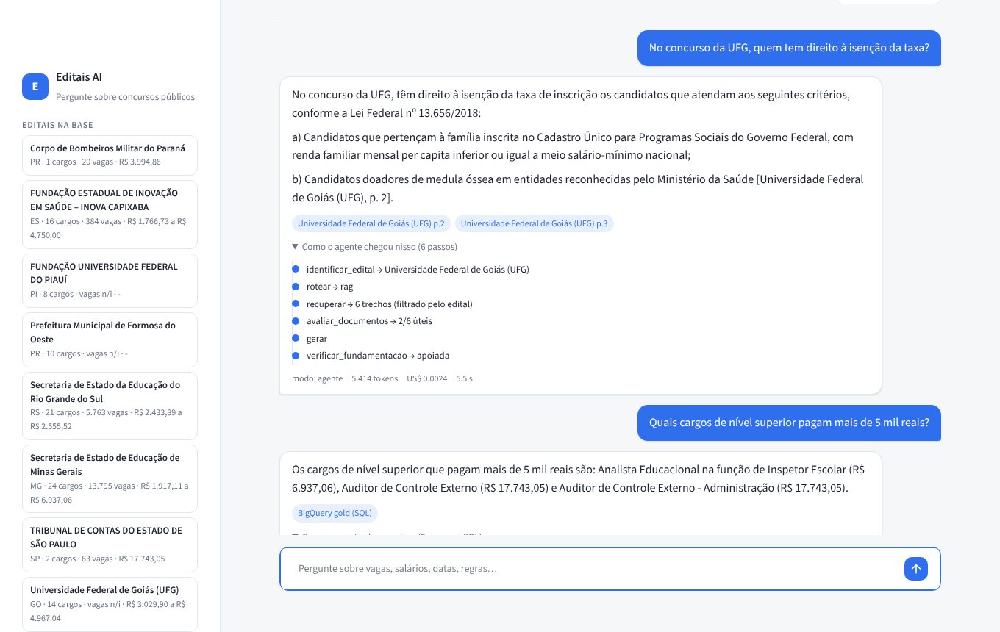
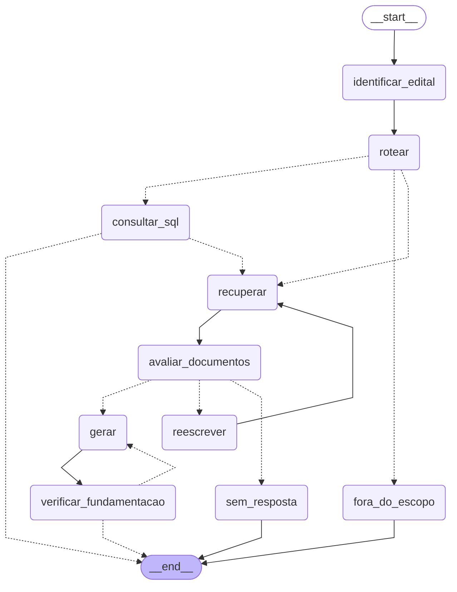
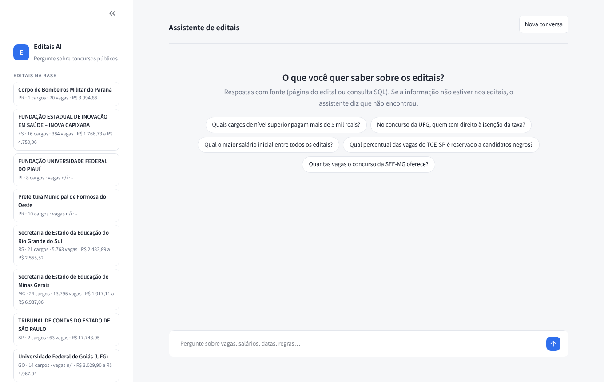
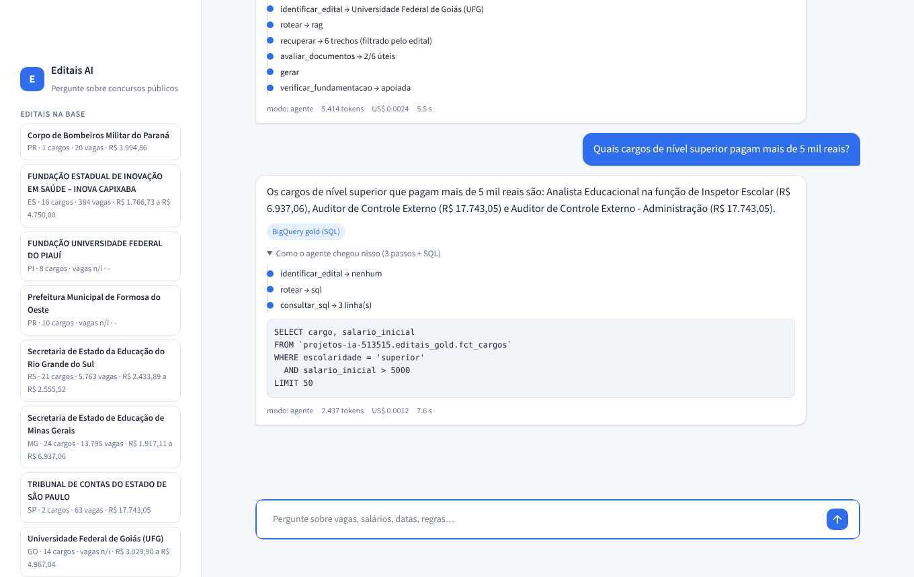
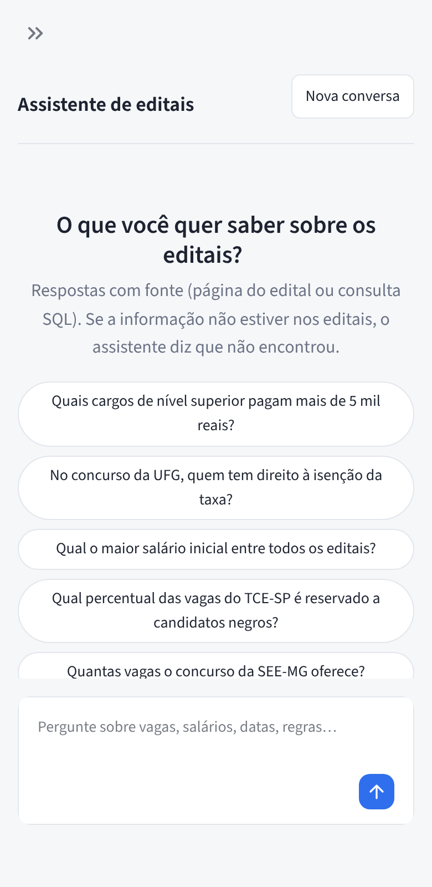

# Editais AI Pipeline



Plataforma de dados que transforma **editais de concurso público** (PDFs longos e não estruturados) em dados consultáveis por **SQL** e por **linguagem natural** (RAG + Text-to-SQL).

## Arquitetura (visão final)

```
              Airflow (Docker)
                    │
 [ingest_editais] ──► Data lake  raw/editais/<sha256>.pdf        ✅ Fase 1
                    │
 [extract_llm] ─────► OpenAI ──► JSON validado (Pydantic)        ⏳ Fase 2
                    │                 │
 [dbt] ─────────────┤        BigQuery bronze → silver → gold     ⏳ Fase 3
                    │
 [index_rag] ───────► chunks + embeddings ──► pgvector           ⏳ Fase 4
                    
 Agente (LangGraph): pergunta ──► Text-to-SQL (BigQuery) ou RAG (pgvector)   ⏳ Fase 5
```

## Roadmap

| Fase | Entrega | Status |
|---|---|---|
| 1 | Ingestão idempotente de PDFs para o data lake (local ou GCS) + manifesto | ✅ |
| 2 | Silver: limpeza de texto + extração estruturada com LLM (cargos, vagas, salários, datas) + avaliação | ✅ |
| 3 | Gold com dbt no BigQuery + testes de qualidade (inclui regressão contra gabarito) | ✅ |
| 4 | RAG no pgvector + Text-to-SQL seguro + roteador + avaliação com `QAEvalChain` | ✅ |
| 5 | Agente LangGraph: identificação do edital + roteamento + CRAG + Self-RAG | ✅ |
| 6 | API (FastAPI) + servidor MCP | ✅ |
| 7 | Interface de chat (Streamlit) consumindo a API | ✅ |

## Stack

Airflow 2.10 · Docker Compose · BigQuery · dbt-core · pgvector · OpenAI · LangChain · LangGraph

## Fase 1: ingestão

DAG `ingest_editais`:

```
list_pdfs ──► ingest (1 task por PDF) ──┬──► manifest           (JSONL no lake)
                                        ├──► load_bigquery      (bronze.ingestion_manifest)
                                        └──► pages_to_bigquery  (bronze.edital_paginas)
```

Tabelas no BigQuery (dataset `editais_bronze`, funciona no **Sandbox**, sem faturamento):

| Tabela | Grão | Partição / cluster |
|---|---|---|
| `ingestion_manifest` | 1 linha por arquivo por execução | `processed_at` / `status` |
| `edital_paginas` | 1 linha por página de cada edital | `loaded_at` / `sha256` |

Decisões de engenharia:
- **Idempotência por conteúdo:** cada PDF é salvo como `raw/editais/<sha256>.pdf`. Rodar de novo, ou receber o mesmo arquivo com outro nome, não gera duplicata nem custo extra nas fases seguintes.
- **Validação na entrada:** arquivos corrompidos ou que não são PDF são rejeitados e registrados, sem derrubar a DAG.
- **Manifesto por execução:** `manifests/ingestion/<run_id>.jsonl` registra o status de cada arquivo (`ingested`, `skipped_duplicate`, `rejected_invalid_pdf`), garantindo rastreabilidade.
- **Storage plugável:** `STORAGE_BACKEND=local` para desenvolver sem GCP; `gcs` para gravar no bucket, sem mudar a DAG.
- **Lake → BigQuery sem custo de LLM:** o texto de cada página é extraído com PyMuPDF e carregado via *load job* (gratuito). Páginas sem texto são marcadas `needs_ocr`, o que indica PDF escaneado.
- **Idempotência no BigQuery:** o Sandbox não aceita `DELETE`/`MERGE`, então antes de carregar consulto quais `sha256` já existem e só envio os novos.
- **Regra de negócio fora da DAG:** a lógica fica em `src/editais/`, testável sem Airflow.

## Fase 2: silver (extração com LLM)

DAG `silver_editais`:

```
clean_pages ──► pending_editais ──► extract (1 task por edital) ──► load_extractions
  (grátis)      (limite max_editais)   (OpenAI + cache no lake)      (silver.editais / silver.cargos)
```

| Tabela | Grão |
|---|---|
| `editais_silver.edital_paginas` | 1 linha por página, texto limpo |
| `editais_silver.editais` | 1 linha por edital × modelo × versão do prompt (com tokens gastos) |
| `editais_silver.cargos` | 1 linha por cargo extraído |

Controles de custo e qualidade:
- **Seleção de páginas:** só as páginas com vagas, remuneração e cronograma vão para o modelo, com teto de tokens (`max_input_tokens`).
- **`max_editais` (padrão 1):** limita quantos editais chamam o LLM por execução.
- **Cache no lake** por `sha256 + modelo + versão do prompt + hash do texto enviado`: reexecutar não paga de novo, e mudar a limpeza ou o prompt invalida o cache automaticamente.
- **Structured output + Pydantic:** o modelo é obrigado a seguir o schema (`extraction_schema.py`), e datas inválidas viram `null` em vez de quebrar a carga.
- **Versão do prompt registrada em cada linha:** dá para comparar `v1` e `v2` lado a lado na silver.

Disparo com parâmetros (exemplo: só um edital):
```bash
airflow dags test silver_editais -c '{"max_editais": 1, "filename": "tce_sp.pdf"}'
```

### Diário de bordo (erros reais encontrados)
1. **pypdf colava palavras** em alguns PDFs ("OTRIBUNALDECON TASDOEST ADO"). Trocado por PyMuPDF na bronze.
2. **Vagas erradas no TCE-SP** (3 e 1 em vez de 59 e 4). Causa: a limpeza removia números soltos achando que eram numeração de página, e apagou a coluna de vagas da tabela. Corrigido (só remove número na 1ª/última linha) e coberto por teste. Como a bronze estava intacta, bastou reprocessar a silver.

3. **Vagas replicadas no edital SEE-MG:** 14 especialidades de Professor saíram com 10.170 vagas *cada uma*; o edital diz "10.170 vagas para os cargos da **carreira** de Professor". O gabarito não pegou (esse edital não está nele); quem pegou foi uma checagem de qualidade em SQL, que virou teste no dbt (`assert_vagas_nao_replicadas`).
4. **Iteração de prompt (v3 → v6):**
   - **v3:** regra "não repita totais" no prompt. **Não funcionou**: o modelo citou o total da carreira nas observações e repetiu mesmo assim.
   - **v4:** em vez de proibir, pedir uma **classificação** (`vagas_referem_se_ao_grupo`) e aplicar a regra **no código** (o valor vai para `vagas_total_grupo`). Resolveu MG, mas o gabarito pegou uma **regressão** no TCE-SP: 63 vagas (59 + 4).
   - **v5:** mais regras contra soma. Continuou 63.
   - **v6:** a causa era uma frase antiga da v2 ("só some a distribuição se...") que incentivava somar. Reescrevi as regras de vagas sem nenhuma instrução de soma. Resultado: 100% no gabarito e MG corrigido.
   - Também entrou uma **checagem de ancoragem** (`grounding.py`): todo número extraído precisa aparecer no texto enviado ao modelo. O "63" seria marcado automaticamente.
   - Lição: prompts que se acumulam começam a se contradizer, e sem gabarito a regressão da v4 teria ido para produção.

### Avaliação da extração

Gabaritos conferidos à mão em `evaluation/gabarito/*.json`. O script compara a silver com o gabarito campo a campo e grava o histórico em `editais_silver.extraction_eval`:

```bash
python scripts/evaluate_extraction.py            # modelo e prompt atuais
python scripts/evaluate_extraction.py --prompt v1 # compara versões
```

Mede: acurácia por campo, recall/precisão dos cargos e **alucinações** (valor preenchido quando o documento não informa; ex.: vagas da UFG, cujo PDF não traz o quadro de vagas).

| Versão | Editais no gabarito | Campos corretos | Cargos (recall / precisão) | Alucinações |
|---|---|---|---|---|
| gpt-4.1-mini / v2 | 2 (TCE-SP, UFG) | 72/72 (100%) | 16/16 / 16/16 | 0 (mas MG errado, fora do gabarito) |
| gpt-4.1-mini / v4 | 2 | 71/72 (98,6%) | 16/16 / 16/16 | 0 (regressão: TCE 63 vagas) |
| gpt-4.1-mini / v5 | 2 | 71/72 (98,6%) | 16/16 / 16/16 | 0 |
| **gpt-4.1-mini / v6** ✅ | 2 | **72/72 (100%)** | 16/16 / 16/16 | 0 (e MG correto) |

## Fase 3: gold (dbt)

DAG `gold_dbt` roda `dbt build` (modelos + testes, na ordem do grafo). O dbt fica num **virtualenv separado** na imagem, porque as dependências dele conflitam com as do Airflow.

```
silver.editais ─► stg_editais (view: extração mais recente por edital) ─┬─► dim_editais
silver.cargos  ─► stg_cargos  (view)                                    ├─► fct_cargos ─► agg_vagas_por_area
silver.extraction_eval ────────────────────────────────────────────────┴─► agg_qualidade_extracao
```

| Modelo (`editais_gold`) | Grão | Para quê |
|---|---|---|
| `dim_editais` | 1 por edital | órgão, banca, datas, status da inscrição, vagas totais, faixa salarial |
| `fct_cargos` | 1 por cargo | base analítica e, na Fase 4, para o Text-to-SQL |
| `agg_vagas_por_area` | área × escolaridade | vagas e salário médio |
| `agg_qualidade_extracao` | versão do prompt × campo | acurácia do LLM ao longo do tempo |

**Vagas de grupo contam uma vez:** no edital SEE-MG a gold calcula 13.795 vagas, exatamente o número escrito no item 1.1 do edital.

Testes de qualidade (23, todos passando):
- Genéricos: `unique`, `not_null`, `relationships`, `accepted_values`, `between` (macro própria: salário entre R$ 1.000 e o teto constitucional; vagas entre 1 e 20.000).
- `assert_vagas_nao_replicadas`: o mesmo número ≥ 50 em ≥ 3 cargos do edital. **Comprovado:** rodando a gold sobre a extração v2 (`dbt build --vars '{prompt_version: v2}'`), o teste falha com 3 casos e o dbt não constrói os modelos seguintes.
- `assert_regressao_gabarito`: a versão de prompt usada na gold não pode ter acurácia < 95% nos gabaritos.
- `assert_datas_coerentes`: fim da inscrição ≥ início; prova ≥ início da inscrição.
- `numeros_ancorados` (warn): vagas/salário que não aparecem no texto do edital.

Trava de custo no `profiles.yml`: `maximum_bytes_billed` de 1 GB por query.

```bash
dbt build --project-dir dbt --profiles-dir dbt
```

## Fase 4: consulta (RAG + Text-to-SQL)

```
pergunta ──► roteador (LLM + structured output) ──┬──► Text-to-SQL ──► BigQuery gold (dim_editais, fct_cargos)
                                                  └──► RAG ─────────► pgvector (chunks dos editais)
```

**Indexação** (DAG `index_rag` ou `python -m editais.rag.index`):
- Texto limpo da `silver.edital_paginas` dividido por **tokens** (`RecursiveCharacterTextSplitter.from_tiktoken_encoder`, 500 tokens, overlap 80), o mesmo tokenizer dos embeddings `text-embedding-3-small`.
- 1.273 chunks dos 8 editais, com metadados (órgão, UF, página) para citar a fonte. Custo: cerca de 477 mil tokens.
- **IDs determinísticos** (`<edital>-p<página>-c<n>`): reexecutar não duplica nem paga embeddings de novo. Trava `RAG_MAX_EMBED_TOKENS` e `--dry-run` para estimar o custo antes.

**RAG** (`rag/rag_chain.py`): cadeia LCEL `retriever | prompt | llm`, top-6 chunks, resposta citando `[órgão, p. N]`.

**Text-to-SQL seguro** (`rag/text_to_sql.py`). O LLM nunca executa nada direto:
1. Structured output (`{sql, explicacao}`).
2. Validação: um único SELECT/WITH, sem DML/DDL, só `dim_editais` e `fct_cargos` (testado contra DELETE, DROP após `;`, INSERT em CTE, UNION com a bronze, outro projeto).
3. **Dry-run** no BigQuery antes de executar (limite de bytes) + `maximum_bytes_billed` + `LIMIT`.
4. **Catálogo de editais no prompt**: o modelo filtra por `edital_id`, não por texto ("TCE-SP" vira o ID certo).
5. Colunas `orgao_norm` / `cargo_norm` (minúsculas, sem acento) criadas no dbt.
6. **Uma autocorreção**: se der erro ou voltar vazio, o modelo recebe o feedback e tenta de novo.

```bash
python scripts/ask.py "Quais cargos de nível superior pagam mais de 5 mil?"      # agente (padrão)
python scripts/ask.py --modo auto "..."                                          # roteador simples (Fase 4)
python scripts/ask.py --modo rag "Quem tem direito à isenção da taxa na UFG?"
```

### Avaliação com `QAEvalChain`

12 perguntas com resposta conferida nos PDFs (`evaluation/qa_dataset.json`): 6 de dados (SQL) e 6 de texto (RAG). O `QAEvalChain` (LLM como juiz) dá CORRECT/INCORRECT. Histórico em `editais_silver.qa_eval`.

| Sistema | Perguntas de dados | Perguntas de texto | Total |
|---|---|---|---|
| Sem RAG (só o LLM) | 1/6 | 2/6 | **3/12**: inventa datas e valores com confiança |
| RAG | 6/6 | 6/6 | **12/12** |
| Roteado, 1ª versão | 3/6 | 6/6 | 9/12 |
| **Roteado + catálogo + normalização + autocorreção** | **6/6** | **6/6** | **12/12** |

O que a avaliação ensinou:
- **Sem contexto o LLM alucina:** "período de inscrição de 10/07 a 10/08", "auxílio de R$ 458".
- **A 1ª versão do Text-to-SQL** errou por casamento de nomes: `'%educacao%'` × `Educação` (acento), `'%tce-sp%'` × `TRIBUNAL DE CONTAS...` (sigla) e filtro por conceito que não é nome de cargo. O RAG não sofre com isso porque a busca é por significado.
- **Por que manter o SQL se o RAG acertou tudo?** Perguntas de agregação ("média salarial por área", "quantos cargos de TI pagam mais de 5 mil") precisam varrer *todos* os cargos. O RAG só vê 6 trechos.

```bash
python scripts/evaluate_qa.py                       # sem_rag, rag e roteado
python scripts/evaluate_qa.py --sistemas roteado    # só um sistema
```

## Fase 5: agente (LangGraph)

`src/editais/rag/agent.py`: um grafo de estados que decide o caminho de cada pergunta.



| Nó | Técnica | O que faz |
|---|---|---|
| `identificar_edital` | entity linking | Acha o concurso citado (nome ou sigla) no catálogo da gold e **filtra a busca vetorial** por ele |
| `rotear` | routing | `sql`, `rag` ou `fora_do_escopo` (structured output) |
| `consultar_sql` | Text-to-SQL seguro | Se der erro ou vier vazio, **cai para o RAG** |
| `avaliar_documentos` | **CRAG** | Uma única chamada classifica os 6 trechos; descarta os irrelevantes |
| `reescrever` | query rewriting | Se nenhum trecho serviu, reescreve com termos de edital e busca de novo (máx. 1x) |
| `verificar_fundamentacao` | **Self-RAG** | Confere se a resposta está apoiada nos trechos; se não, gera de novo com regra mais rígida (máx. 1x) |
| `sem_resposta` | | Responde "não encontrei" em vez de inventar |

Cada execução devolve a trilha (`steps`), útil no LangSmith e para depurar:
```
identificar_edital → UFG > rotear → rag > recuperar → 6 trechos (filtrado pelo edital)
> avaliar_documentos → 2/6 úteis > gerar > verificar_fundamentacao → apoiada
```

### Avaliação (17 perguntas, `QAEvalChain`)

| Sistema | Dados (SQL) | Texto (RAG) | Agregação | Fora da base | **Total** | Tokens/pergunta | **US$/pergunta** |
|---|---|---|---|---|---|---|---|
| Sem RAG | 1/6 | 3/6 | 0/3 | 1/2 | 5/17 | 84 | 0,0001 |
| RAG | 6/6 | 6/6 | **0/3** | 2/2 | 14/17 | 2.305 | 0,0010 |
| Roteado (Fase 4) | 6/6 | 6/6 | 3/3 | 2/2 | **17/17** | 2.330 | 0,0012 |
| Agente (Fase 5) | 6/6 | 6/6 | 3/3 | 2/2 | **17/17** | 4.094 | 0,0019 |

Leitura honesta:
- **RAG puro não faz agregação:** "maior salário entre todos os editais" exige olhar os 96 cargos, e ele só vê 6 trechos (respondeu R$ 13.731 de um posto de carreira dos Bombeiros). É por isso que existe o caminho SQL.
- **Sem RAG o LLM inventa:** "Delegado da PF ganha R$ 24.500", "inscrições de 10/07 a 10/08".
- **Agente × roteado empataram nesta amostra.** O agente custa cerca de 1,6x mais. Ele compra robustez que esta amostra pequena não mede: filtro por edital (evita misturar concursos), verificação de fundamentação e "não sei" garantido quando nada serve.
- **Onde o agente gasta mais:** perguntas de texto que o roteador manda primeiro ao SQL (SQL → vazio → RAG). Melhorar o roteador é a otimização de custo mais óbvia.

### Custo por pergunta (medido)

Tokens contados com `get_usage_metadata_callback` do LangChain em cada pergunta. Preços de referência do `gpt-4.1-mini` (US$ 0,40/1M entrada, US$ 1,60/1M saída), configuráveis no `.env`:

| Caminho do agente | Custo típico |
|---|---|
| Pergunta de dados (SQL direto) | cerca de US$ 0,0013 |
| Pergunta de texto (RAG + CRAG + Self-RAG) | US$ 0,0012 a 0,0046 |
| Fora da base (reescreve e desiste) | cerca de US$ 0,003 |
| **Média** | **cerca de US$ 0,002 por pergunta (cerca de US$ 2 por 1.000 perguntas)** |

Os embeddings da pergunta (cerca de 20 tokens) e as consultas ao BigQuery (free tier) são desprezíveis.

## Fase 6: API (FastAPI) + MCP

`src/editais/api/`: o agente exposto de duas formas, sobre a **mesma camada de serviço** (`service.py`).

| Endpoint | O que faz |
|---|---|
| `POST /api/ask` | `{"pergunta": "...", "modo": "agente" \| "sql" \| "rag"}` → resposta, fontes, caminho do agente, SQL, tokens, custo e latência |
| `GET /api/editais` | catálogo da gold (órgão, UF, cargos, vagas, faixa salarial) |
| `GET /api/stats` | perguntas e gasto do dia |
| `GET /docs` | Swagger |

Proteções (uma API pública com LLM sem limites é um risco financeiro):
- **Limite de gasto diário** (`DAILY_BUDGET_USD`): após atingir o valor, responde 429.
- **Rate limit** por IP (`RATE_LIMIT_PER_MIN`) e **API key** opcional (`X-API-Key`).
- Validação da pergunta (3 a 500 caracteres) e do modo (Pydantic).

**Servidor MCP** (`mcp_server.py`, SDK `mcp` 2.x): ferramentas `perguntar_editais` e `listar_editais`, só leitura e com o mesmo limite de gasto. Para usar no Claude Desktop, adicione em `claude_desktop_config.json`:

```json
{
  "mcpServers": {
    "editais": {
      "command": "/caminho/do/venv/bin/python",
      "args": ["-m", "editais.api.mcp_server"],
      "env": {"PYTHONPATH": "/caminho/editais-ai-pipeline/src", "OPENAI_API_KEY": "...",
              "GCP_PROJECT_ID": "...", "GOOGLE_APPLICATION_CREDENTIALS": "/caminho/credentials/gcp-sa.json"}
    }
  }
}
```

Ou via HTTP: `docker compose --profile mcp up mcp` → `http://localhost:8001/mcp`.

## Fase 7: chat (Streamlit)

`streamlit_app/`: interface de conversa que **só fala com a API** (não acessa OpenAI, BigQuery nem pgvector). Assim, as proteções da API valem também para a UI.

- Barra lateral com os editais da base, o modo (agente / SQL / RAG) e o gasto do dia.
- Sugestões de perguntas, balões de conversa e fontes em destaque.
- "Como o agente chegou nisso": a trilha de nós do LangGraph e o SQL gerado.
- Tokens, custo em US$ e latência de cada resposta.
- Visual próprio (`styles.css`) sobre o Streamlit; funciona no celular.

| Início | Pergunta de dados (SQL) | Celular |
|---|---|---|
|  |  |  |

```bash
docker compose up -d pgvector api ui        # chat em http://localhost:8501 · API em http://localhost:8000/docs
```

## Como rodar

Pré-requisito: Docker Desktop (ou Docker Engine + Compose).

```bash
cp .env.example .env          # ajuste se quiser (no Linux: AIRFLOW_UID=$(id -u))
docker compose build
docker compose up airflow-init
docker compose up -d
```

Acesse http://localhost:8080 (login `admin` / `admin`).

1. Coloque PDFs de editais em `data/landing/`
2. Ative e dispare a DAG `ingest_editais`
3. Veja o resultado em `data/lake/raw/editais/` e `data/lake/manifests/`

Atalhos: `make init`, `make up`, `make down`, `make logs`, `make test`.

### Usando o GCS

1. Crie um bucket e uma service account com papel **Storage Object Admin** nesse bucket
2. Salve a chave JSON em `credentials/gcp-sa.json` (já ignorada pelo git)
3. No `.env`: `STORAGE_BACKEND=gcs` e `GCS_BUCKET=<seu-bucket>`
4. Reinicie: `docker compose up -d`

> 💰 Crie um **alerta de orçamento** no GCP e um **limite de gasto** na OpenAI antes de começar.

## Testes

```bash
pip install pypdf pymupdf openai pydantic pytest reportlab -r requirements-rag.txt -r requirements-api.txt
python -m pytest -q        # 43 testes (os de Text-to-SQL exigem as deps de RAG)
```

## Estrutura

```
├── dags/ingest_editais.py      # DAG (só orquestração)
├── src/editais/
│   ├── config.py               # settings via variáveis de ambiente
│   ├── storage.py              # data lake: LocalStorage | GCSStorage
│   ├── ingestion.py            # regras: hash, validação, idempotência, manifesto
│   ├── text_extraction.py      # PDF -> 1 linha por página
│   ├── cleaning.py             # limpeza do texto (silver)
│   ├── page_selection.py       # escolhe as páginas que vão para o LLM
│   ├── extraction_schema.py    # contrato Pydantic do edital/cargo
│   ├── llm_extraction.py       # OpenAI + cache + versão do prompt
│   ├── grounding.py            # o número extraído existe no texto?
│   ├── evaluation.py           # métricas: acurácia, recall, alucinação
│   └── warehouse.py            # tabelas e cargas no BigQuery
├── dags/silver_editais.py      # DAG da silver
├── dags/gold_dbt.py            # DAG da gold (dbt build)
├── dags/index_rag.py           # DAG de indexação no pgvector
├── src/editais/rag/            # RAG, Text-to-SQL, roteador, agente LangGraph
├── src/editais/api/            # FastAPI (main.py), serviço com limite de gasto, servidor MCP
├── streamlit_app/              # chat (Streamlit + styles.css)
├── Dockerfile.api / Dockerfile.ui
├── docs/img/                   # capturas do chat
├── scripts/ask.py              # perguntar pelo terminal
├── scripts/evaluate_qa.py      # avaliação com QAEvalChain
├── evaluation/qa_dataset.json  # perguntas com resposta conferida
├── requirements-rag.txt        # deps da camada de consulta (venv isolado)
├── dbt/                        # projeto dbt: staging, gold, testes, macros
├── evaluation/gabarito/        # gabaritos conferidos à mão
├── scripts/evaluate_extraction.py
├── tests/                      # pytest
├── db/init/                    # cria a extensão pgvector
├── data/landing/               # PDFs de entrada (não versionados)
├── data/lake/                  # data lake local (não versionado)
├── docker-compose.yml
└── Dockerfile
```
